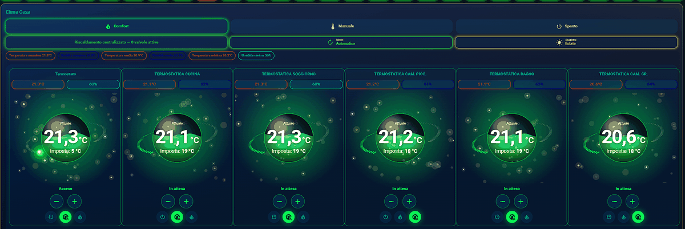
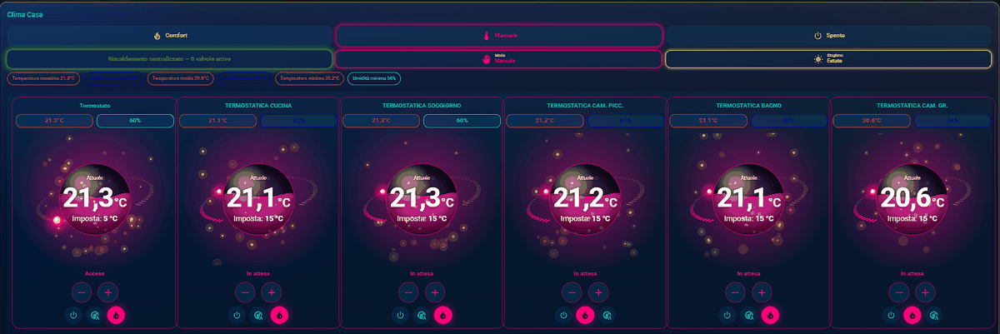
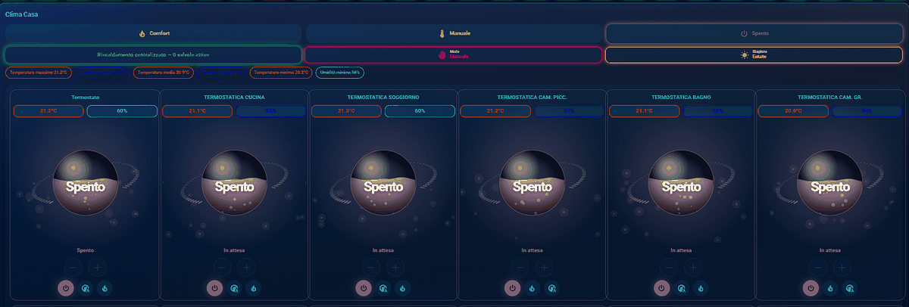
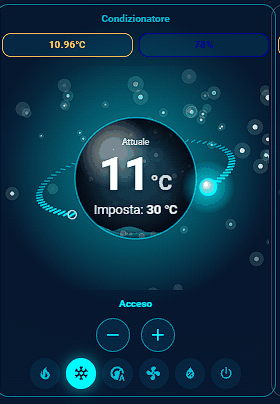
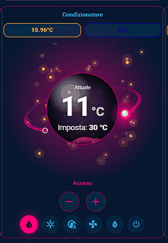
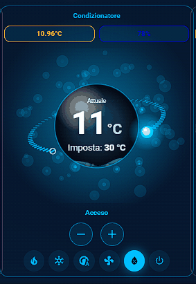

# Thermo Orb Card

A single Lovelace card for Home Assistant that gathers all your climate devices as animated **3D orbs**: thermostats, thermostatic valves, air conditioners, fans, humidifiers / dehumidifiers and plain temperature/humidity sensors.

Everything is optional. The card only shows entities that exist and have a usable state, so it adapts to any setup without empty placeholders.

**Documentation:** English · [Italiano](README.it.md)

## Features

- One orb per `climate`, `fan` or `humidifier` entity, plus sensor-only orbs. The orb colour and animation follow the device state (heating, cooling, drying, humidifying, fan, idle, off).
- Large current temperature, target temperature, a draggable bead on the ring and +/− buttons. HVAC mode buttons, fan speed, fan mode and preset selectors, target humidity: controls appear only if the entity supports them.
- Two layouts: **select** (one room or device at a time, chosen with chips) or **grid** (all rooms side by side).
- Devices can be grouped in rooms, or simply listed without a room.
- Optional global mode buttons (for example Comfort / Manual / Off) tied to an `input_select` helper.
- Optional central heating row (for example "number of open valves").
- Optional manual/automatic and summer/winter chips, shown next to the central heating row.
- Optional house chips: minimum, average and maximum temperature and humidity, coloured by range.
- Per-room temperature and humidity chips next to each orb.
- Sizes of the numbers, buttons and selectors adjustable separately, and a colour for every orb state.
- Full visual editor and Italian/English interface, based on your Home Assistant language. Works on phones.

## Screenshots

| Auto | Manual | Off |
| --- | --- | --- |
|  |  |  |

Air conditioner with its own controls and colours: cooling, heating and dehumidifying.

| Cool | Heat | Dry |
| --- | --- | --- |
|  |  |  |

## Installation

### HACS (recommended)

1. HACS → ⋮ → **Custom repositories**.
2. Add this repository URL with category **Dashboard**.
3. Install **Thermo Orb Card** and reload the browser.

If the resource is not added automatically, add `/hacsfiles/thermo-orb-card/thermo-orb-card.js` as a *JavaScript module* in **Settings → Dashboards → ⋮ → Resources**.

### Manual

1. Copy `thermo-orb-card.js` to `/config/www/`.
2. Add `/local/thermo-orb-card.js` as a *JavaScript module* in **Settings → Dashboards → ⋮ → Resources**.

After updating the file, add a version to the URL (for example `/local/thermo-orb-card.js?v=2`) or clear the browser / companion app cache, otherwise Home Assistant may keep serving the old copy.

## Adding the card

Add a **Thermo Orb (clima 3D)** card and configure it from the visual editor, or in YAML:

```yaml
type: custom:thermo-orb-card
title: Climate
layout: select
mode_entity: input_select.thermo_orb_mode
central_heating_entity: sensor.thermo_orb_active_valves
temperature_avg_entity: sensor.thermo_orb_temperature_avg
temperature_max_entity: sensor.thermo_orb_temperature_max
temperature_min_entity: sensor.thermo_orb_temperature_min
humidity_avg_entity: sensor.thermo_orb_humidity_avg
humidity_max_entity: sensor.thermo_orb_humidity_max
humidity_min_entity: sensor.thermo_orb_humidity_min
rooms:
  - name: Living room
    icon: mdi:sofa
    entities:
      - climate.living_room
      - climate.living_room_valve
    temperature_entity: sensor.living_room_temperature
    humidity_entity: sensor.living_room_humidity
  - name: Bedroom
    entities:
      - climate.bedroom_ac
  - name: Bathroom
    entities:
      - humidifier.bathroom_dehumidifier
    humidity_entity: sensor.bathroom_humidity
  - name: Hallway
    temperature_entity: sensor.hallway_temperature
```

Devices that do not belong to a room can be listed at the top level instead, each with its own sensors:

```yaml
type: custom:thermo-orb-card
layout: select
entity_columns: 1
entities:
  - climate.living_room_thermostat
  - climate.kitchen_valve
  - fan.dehumidifier
loose_sensors:
  climate.living_room_thermostat:
    temperature_entity: sensor.living_room_temperature
    humidity_entity: sensor.living_room_humidity
  climate.kitchen_valve:
    temperature_entity: sensor.kitchen_temperature
```

All keys except the devices themselves are optional: leave out whatever you do not need.

### Options

| Key | Description |
| --- | --- |
| `title` | Title shown above the card. |
| `layout` | `select` = one room/device at a time, chosen with chips. `grid` = all rooms side by side. If omitted: `grid` when `columns` is set or rooms use `climate_entity`, otherwise `select`. |
| `room_columns` | Rooms per row in `grid` layout. Empty = automatic. (`columns` is accepted as an alias.) |
| `entity_columns` | Orbs per row for devices without a room. Default `1`. |
| `rooms` | List of rooms (below). |
| `entities` | Devices without a room. Each item is an entity ID or an object with `entity`, `name`, `temperature_entity`, `humidity_entity`. |
| `loose_sensors` | Temperature/humidity sensors for devices without a room: `entity_id: {temperature_entity, humidity_entity}`. The visual editor writes this for you. |
| `rooms[].name` | Room title. |
| `rooms[].icon` | Room icon. Default depends on the device type. |
| `rooms[].entities` | `climate`, `fan` or `humidifier` entities. A room with no entities but a temperature or humidity sensor becomes a sensor-only orb. |
| `rooms[].temperature_entity` | Room temperature sensor, shown as a chip next to the orb. For `climate` entities the `current_temperature` attribute is used when this is missing. |
| `rooms[].humidity_entity` | Room humidity sensor. The humidity chip only appears when this is set. |
| `rooms[].orb_columns` | Orbs per row inside this room. Default `1`. |
| `mode_entity` | `input_select` used for the global mode buttons. The buttons are hidden if it is missing or unavailable. |
| `mode_options` | Global buttons: `option` (a value of the helper, case ignored), `label`, `icon`, `color`. Default: `auto` → *Comfort*, `heat` → *Manual*, `off` → *Off* (translated to Italian automatically). A button whose `option` does not exist in the helper is hidden. |
| `central_heating_entity` / `central_heating_label` | Status row. A number above 0 is shown as active and blinks red, otherwise green. Tap for details. |
| `manual_auto_entity` | Optional manual/automatic chip. Accepts `input_boolean`, `switch`, `binary_sensor`, `input_select`, `select`, `sensor`. |
| `manual_auto_on` | For boolean entities: what *on* means, `manual` or `auto`. Detected from the entity name when omitted. |
| `manual_auto_options` | Custom label/icon/color per state: list of `option`, `label`, `icon`, `color`. |
| `season_entity` | Optional summer/winter chip. Same accepted domains. |
| `season_on` | For boolean entities: what *on* means, `summer` or `winter`. Detected from the entity name when omitted. |
| `season_options` | Custom label/icon/color per state, like `manual_auto_options`. |
| `modes_readonly` | `true`: tapping the manual/automatic and season chips only opens the details instead of changing the state. |
| `temperature_avg_entity`, `temperature_max_entity`, `temperature_min_entity` | Numeric sensors for the house temperature chips. |
| `humidity_avg_entity`, `humidity_max_entity`, `humidity_min_entity` | Numeric sensors for the house humidity chips. |
| `temp_thresholds` | `[low, high]` for the temperature chip colours. Default `[18, 22]` °C. YAML only. |
| `humidity_thresholds` | `[low, high]` for the humidity chip colours. Default `[40, 60]` %. YAML only. |
| `current_size` | Size of the large current temperature, 50–200 %. Default `100`. The orb scales with it. |
| `target_size` | Size of the target temperature text, 50–200 %. |
| `room_chips_size` | Size of the room temperature/humidity chips, 50–200 %. |
| `step_buttons_size` | Size of the + and − buttons, 50–200 %. |
| `selectors_size` | Size of mode selectors and controls, 50–200 %. |
| `orb_color` | Fallback orb colour for every state. |
| `orb_color_auto`, `_manual`, `_off`, `_heat`, `_heat_demand`, `_cool`, `_dry`, `_humid`, `_fan` | Orb colour per state, e.g. `orb_color_heat`. `_heat_demand` is used while the device reports `hvac_action: heating`. Colours are `[r, g, b]` or `'#rrggbb'`. |

### Good to know

- A device or room is hidden if none of its entities has a usable state (`unknown` / `unavailable`).
- Chips (house values, room values, manual/automatic, season, central heating) only appear when their entity exists and has a usable value.
- The global mode buttons **only change the helper**. Something must react and command the devices: the optional package below does it for `climate` entities.
- If you use your own helper, each `option` in `mode_options` must match one of its options. Case does not matter (`auto` matches `Auto`) and the card always sends the exact helper value.
- Tapping a manual/automatic or season chip toggles a boolean or cycles through the options of an `input_select`; a long press (half a second) opens the details.
- Each orb takes its colour from the device's own mode: a device in `auto` uses `orb_color_auto`, a device in `heat` uses `orb_color_manual` (or `orb_color_heat` if not set), and a device reporting `hvac_action: heating` uses `orb_color_heat_demand`. So with the global mode on Auto, a single device you switch to heat shows the manual colour. If `manual_auto_entity` is text such as `Manual` / `Auto` (for example an `input_select`), devices in `heat` follow that global state instead.
- Temperatures are shown in the unit of your Home Assistant installation.

## Optional package: global modes and house statistics

[`packages/thermo_orb.yaml`](packages/thermo_orb.yaml) creates the helper, the automation and the house sensors, including the optional valve count:

- `input_select.thermo_orb_mode` with the options `auto`, `heat`, `off`
- an automation that applies the chosen mode to your `climate` entities
- `sensor.thermo_orb_active_valves`, counting the configured valves with `hvac_action: heating`
- `sensor.thermo_orb_temperature_avg` / `_max` / `_min`
- `sensor.thermo_orb_humidity_avg` / `_max` / `_min`

**Requirements:** Home Assistant 2025.10 or newer. Source sensors must report °C and %: °F values are not converted, so convert them first.

### Setup

1. Copy the file to `/config/packages/`.
2. Make sure packages are enabled in `configuration.yaml` (if you already have a `homeassistant:` section, add `packages:` inside it):

   ```yaml
   homeassistant:
     packages: !include_dir_named packages
   ```

3. Edit the four places marked `EDIT ME` in the file:
   - your `climate` entities (automation),
   - the thermostatic valve `climate` entities to count (only those with an `hvac_action` attribute),
   - the room temperature sensors,
   - the room humidity sensors.

   Each list is written once and reused by every mode/statistic.
4. **Settings → System → Restart** (check the configuration first).
5. In the card set `mode_entity: input_select.thermo_orb_mode`, `central_heating_entity: sensor.thermo_orb_active_valves` and the six `*_entity` keys from the example above. `mode_options` is not needed: the card defaults match the package. Averages are computed from the source sensors you list in the two `EDIT ME` lists, and are already part of the package.

### Notes

- Each device receives the mode with `climate.set_hvac_mode`, so it must support `auto`, `heat` and `off`. If some do not, give that mode its own list in the automation instead of reusing the shared one.
- The central count treats configured valves with `hvac_action: heating` as active; the sensor only counts the items you add to its list. If you do not want the row, leave `central_heating_entity` out of the card.
- Fans and humidifiers are not touched by the automation: they use different services.
- The manual/automatic and summer/winter chips are not created by the package: they are meant for people who already have such entities. Leave `manual_auto_entity` and `season_entity` out if you do not.
- Until you replace the placeholder entity IDs, the automation logs an error when you press a mode and the statistic sensors are `unknown` (the card then hides the chips).

## Troubleshooting

- **"Custom element doesn't exist"**: the resource is not registered; check the Resources page and clear the browser cache.
- **The card looks unchanged after an update**: Home Assistant is still serving the old file; change the version in the resource URL (`?v=2`) or clear the cache.
- **A mode button is missing**: its `option` does not match any option of the helper (case is ignored).
- **A chip is missing**: its sensor is not configured or has no numeric state.
- **A room or orb is missing**: none of its entities has a usable state.
